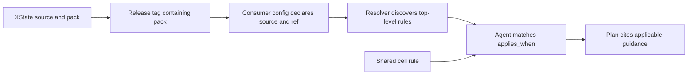

# XState Compound Pack - Plan

## Goal Capsule

- **Objective:** Make consistent XState guidance available to agents across first-party repositories without making cell architecture own library-specific APIs.
- **Means:** Publish a separately declared pack with the XState source and narrow the existing cell-state rule to its ownership decision.
- **Product authority:** The owner requested a separate pack, cross-repository enrollment, and a requirements document before implementation.
- **Open blockers:** None for planning. Publishing the source pack and changing consumer repositories require work in those repositories.

## Product Contract

### Summary

Provide versioned XState usage rules from the library's repository, and declare that pack throughout participating first-party repositories. Keep cell architecture responsible for state ownership and the decision to use a machine, not the details of XState APIs.

### Problem Frame

The current cell-architecture rule keeps instance ownership but lacks the machine decision. Library-specific guidance belongs in its own declared pack so agents can discover guidance versioned with the fork.

### Key Decisions

- **Library-owned pack.** Place the pack in `systemfsoftware/xstate`, versioned with the library source, rather than in a separate repository. Follow that repository's existing Compound Engineering conventions, or the `systemfsoftware` compound-packs layout and the EveryInc packs guide if none exist. Governs R1, R2.
- **Enroll before first use.** Declare the pack in every participating first-party repository, including those without an XState dependency; the resolver does not enroll packs from dependencies. Each rule's `applies_when` determines applicability. Governs R3, R4.
- **Separate selection from implementation.** Cell architecture retains its state-ownership decision and cites the XState pack for library-specific usage. Governs R12, R13.

### Requirements

**Source and enrollment**

- R1. Place the XState pack in `systemfsoftware/xstate` as a resolver-readable source directory, with its rule files versioned alongside that repository's releases.
- R2. A consumer's declared pack ref follows KTD2; state that rule in the pack README and enrollment instructions. Do not add a CI check or gate.
- R3. Enroll the pack in each participating first-party repository, including the library repository itself and repositories not yet depending on an `@systemfsoftware/xstate*` package.
- R4. Declare the pack explicitly in each repository's `.compound-engineering/config.yaml`, preserving existing pack entries and avoiding duplicate pack IDs.
- R5. State that a package dependency, Nix `file:` catalog entry, or installed tarball alone does not enroll a pack under the current resolver.
- R6. Verify that the declared source resolves to the intended pack and that applicable rules are selected in a real agent session; discovery alone is not evidence of uptake.

**Rule coverage**

- R7. Specify how to choose a named-state machine, an observable store, or a plain keyed table or counter based on the state and its transitions and subscriptions.
- R8. Specify that a machine actor belongs to its Layer-built service and is started and stopped with that service's scope.
- R9. Forbid hand-rolled status-field machines where the machine decision in R7 applies, and forbid global or module-level live actors.
- R10. Require machine tests to exercise model paths with `@systemfsoftware/xstate-test` against observable behavior rather than certify a mocked implementation against itself.
- R11. Require typed events and guards at the machine boundary, using APIs actually exported by the selected fork version.
- R12. Keep the named-state machine and Layer ownership decision in `compound-packs/cell-architecture/instance-state-lives-in-the-constructor.md` and cross-link the XState pack for its detailed rules.
- R13. Remove library-specific API instructions from that cell-architecture rule without removing its existing state ownership, cache and request-context boundaries.
- R14. Give every rule a clear scope, situational `applies_when`, defined decision terms, and at most one short WRONG/RIGHT pair, following the local pack conventions. (pack: cell-architecture, instance-state-lives-in-the-constructor.md)
- R15. Cite every named API and example from this repository's source at its current main, and record any experimental API status.

### Acceptance Examples

- AE1. **Covers R3-R5.** A first-party repository without XState installed still declares the pack; merely adding a dependency does not make the resolver load it.
- AE2. **Covers R7-R9.** A connection lifecycle has an owned scoped machine actor, while an unsubscribed keyed counter remains a service-owned table or reference.
- AE3. **Covers R10-R11, R15.** A machine with typed events is tested through model paths and externally observable outcomes, using a test API verified in the fork rather than an invented import.
- AE4. **Covers R6, R12-R13.** A real agent session planning a stateful service identifies the relevant declared guidance and its source; the cell rule does not duplicate library-specific instructions.

### Scope Boundaries

- This document changes no pack, application, dependency, repository enrollment, or CI configuration.
- No new enforcement gate is authorized by this requirements document. Pack rules guide agent judgment and do not themselves enforce dependency-based enrollment.
- UI atom consumption and schema tagged unions remain governed by their existing rules; the XState pack must not duplicate or contradict those boundaries.
- The existing module-state plan is a separate artifact. If both plans are proposed in one PR, consolidate them first to satisfy REPO-D2.

### Dependencies and Assumptions

The rollout covers first-party repositories participating in the shared Compound Engineering conventions, not arbitrary third-party repositories. Establish the complete repository inventory and each consumer's exact declaration during planning; enroll other repositories through follow-up PRs in those repositories.

Git pack refs and Nix package versions are independent inputs. A release tag or commit must actually contain the pack before consumers can pin it; a repo hosted pack does not by itself put rules in a published npm tarball. The resolver warns and continues when a Git source is unreachable, so declared enrollment is not a fail-closed guarantee.

### Sources

- [Compound Packs guide](https://github.com/EveryInc/compound-engineering-plugin/blob/main/docs/guides/packs.md): declared sources, pinned Git refs, pack discovery, rule matching and source cache behavior.
- `compound-packs/README.md` and `.compound-engineering/config.yaml`: local rule shape, enrollment and the 13 currently declared roots. The local `ce-brainstorm` `scripts/packs-resolve.py` reads CE configuration entries and path or Git sources, not dependency manifests.
- Fork source at `688aabff96cee96c168d80b277b7616f9faca67d`: [`@systemfsoftware/xstate` exports `createMachine` and `setup`](https://github.com/systemfsoftware/xstate/blob/688aabff96cee96c168d80b277b7616f9faca67d/packages/xstate/src/index.ts), with typed schemas and guards in [`setup`](https://github.com/systemfsoftware/xstate/blob/688aabff96cee96c168d80b277b7616f9faca67d/packages/xstate/src/setup.ts).
- Fork source: [`@systemfsoftware/xstate-effect` exports `createEffectActor`](https://github.com/systemfsoftware/xstate/blob/688aabff96cee96c168d80b277b7616f9faca67d/packages/xstate-effect/src/index.ts), whose [implementation](https://github.com/systemfsoftware/xstate/blob/688aabff96cee96c168d80b277b7616f9faca67d/packages/xstate-effect/src/createEffectActor.ts) starts an actor and releases it with its enclosing scope.
- Fork source: [`@systemfsoftware/xstate-store` exports `createStore`](https://github.com/systemfsoftware/xstate/blob/688aabff96cee96c168d80b277b7616f9faca67d/packages/xstate-store/src/index.ts); [`@systemfsoftware/xstate-test` exports `testPaths`](https://github.com/systemfsoftware/xstate/blob/688aabff96cee96c168d80b277b7616f9faca67d/packages/xstate-test/src/index.ts), documented as experimental in its [implementation](https://github.com/systemfsoftware/xstate/blob/688aabff96cee96c168d80b277b7616f9faca67d/packages/xstate-test/src/propertyTest.ts).

---

## Planning Contract

Product Contract changed: R2 and the problem frame reflect the accepted review rulings.

### Key Technical Decisions

- KTD1. **Publish one Git-sourced pack.** Create `compound-packs/xstate/` with top-level rule files and a README. Remote declarations use the repository URL and this exact subdirectory; the source repository uses a local path declaration. The resolver treats the README as descriptive, not as a rule.
- KTD2. **Couple the pack ref to the core release.** A consumer's pack ref is the `@systemfsoftware/xstate` release tag for the core version its lockfile resolves, whether directly or transitively through `@systemfsoftware/xstate-effect`. Tags of other packages, such as xstate-effect or xstate-store, are never used as the pack ref and need not equal it. A consumer whose lockfile resolves no core `@systemfsoftware/xstate` uses the first pack-bearing core tag recorded in U5.
- KTD3. **Separate the decision from API detail.** The shared cell rule owns instance state and the machine-versus-other-state decision; the XState pack owns concrete fork APIs. The shared rule at the current default branch retains instance ownership but no longer contains the machine decision, so restore that decision rather than assuming a removable XState API section still exists.
- KTD4. **Validate uptake, not just declaration.** Inspect resolver output and an actual planning session's cited rule selection. An unreachable Git source warns and continues; neither a config entry nor a successful resolution proves the agent used a rule.

### High-Level Technical Design



### Source Evidence

All fork API claims below are grounded at commit `688aabff96cee96c168d80b277b7616f9faca67d`, not upstream XState:

- `packages/xstate/src/index.ts` exports `setup`, `createMachine`, and `types`; `packages/xstate/src/setup.ts` defines setup schemas, guards, and machine creation.
- `packages/xstate-effect/src/index.ts` exports `createEffectActor`; `packages/xstate-effect/src/createEffectActor.ts` documents acquisition, startup, and scope-driven interruption and release.
- `packages/xstate-store/src/index.ts` exports `createStore`; `packages/xstate-store/src/store.ts` defines its observable store.
- `packages/xstate-test/src/index.ts` exports `testPaths`; `packages/xstate-test/src/propertyTest.ts` marks it experimental and describes path execution against a system under test. Do not substitute another package's model-test API.
- `release.jsonc` describes per-package release tags; `packages/xstate/package.json` includes only `dist` in the package payload. Git pack distribution and package tarball contents are distinct.
- The [Compound Packs guide](https://github.com/EveryInc/compound-engineering-plugin/blob/main/docs/guides/packs.md) specifies the entry shape, top-level frontmatter, ignored README, semantic matching and Git-source failure behavior.

### Assumptions and Dependencies

- Participating public repositories are the unarchived first-party repositories with a tracked `.compound-engineering/config.yaml`, plus this library. Recheck the inventory before enrollment; a repository becoming a participant is not excluded by the snapshot.
- The first pack-bearing core release tag and consumers' resolved core lockfile versions are future inputs. No literal ref can be truthfully specified before that release exists.
- The library's own declaration is path-sourced and has no Git ref.

---

## Implementation Units

### U1. Publish XState pack rules

**Goal:** Give agents source-backed rules for representation, actor lifetime, typed boundaries and model paths.

**Requirements:** R1, R5, R7-R11, R14-R15; AE2-AE3.

**Dependencies:** None.

**Files:** Create `compound-packs/xstate/README.md`, `compound-packs/xstate/choose-state-representation.md`, `compound-packs/xstate/scope-machine-actors.md`, `compound-packs/xstate/type-events-and-guards.md`, and `compound-packs/xstate/test-machine-paths.md`.

**Approach:** Define named-state machine, observable store and keyed table in the choice rule. Make rule scopes and matching situations distinct. Use the APIs and experimental status in Source Evidence; cite exact source at the release being documented. Document KTD2 and the consumer declaration in the README.

**Test expectation:** No new permanent test or gate: these files specify guidance and configuration rather than executable behavior.

**Verification:** Before U5, write 6 to 8 short code fixtures covering lifecycle versus status field, store versus Ref, keyed counter, and actor ownership inside versus outside a Layer scope. Give two independent agents only the rule texts and fixtures; each records for every fixture which rule applies and the required change. Any disagreement is a rule-text defect: fix it and rerun the check before release. Resolver output and citations alone do not satisfy this check. Inspect each rule's frontmatter. After U5 and U3, inspect resolver output and use a real agent session for the lifecycle, keyed-counter and model-path scenarios in AE2-AE3. Ensure the selected guidance points to the fork and does not assert that installation enrolls a pack.

### U5. Release the pack

**Goal:** Cut the first `@systemfsoftware/xstate` release whose tag contains `compound-packs/`.

**Requirements:** R1-R2.

**Dependencies:** U1.

**Files:** Release metadata and changeset files as required by the existing release process.

**Approach:** Obtain the required human approval and use the existing release process. Record the actual first pack-bearing `@systemfsoftware/xstate` release tag for U3 and subsequent enrollments. Do not invent a tag or enroll consumers before it exists.

**Test expectation:** No new permanent test or gate for the release instruction.

**Verification:** Inspect the released tag's repository tree and confirm it contains the pack and the intended rule files.

### U2. Restore the shared ownership boundary

**Goal:** Keep state ownership and the choice of a machine in cell architecture without duplicating XState API instructions.

**Requirements:** R7, R12-R14; AE4.

**Dependencies:** U5 and the `systemfsoftware/systemfsoftware` enrollment in U3.

**Target repository:** `systemfsoftware/systemfsoftware`.

**Files:** Modify `compound-packs/cell-architecture/instance-state-lives-in-the-constructor.md` and `.compound-engineering/config.yaml`.

**Approach:** Preserve the rule's instance-owned mutable state, cache and request-context boundaries. Add the named-state and Layer ownership decision and a link to the published XState pack. Do not duplicate its library API instructions. Enroll this repository using U3.

**Test expectation:** No permanent test: verify the rule's text and agent selection rather than introducing a configuration gate.

**Verification:** A scoped service planning session cites both the cell ownership rule and applicable XState guidance; a plain table case remains valid.

### U3. Enroll public consumers

**Goal:** Explicitly declare the pack in each identified public participating repository.

**Requirements:** R2-R6; AE1, AE4.

**Dependencies:** U5.

**Files:** `.compound-engineering/config.yaml` in each target repository in the inventory below.

**Approach:** Each public repository below is an independent follow-up unit and PR. For Git-sourced consumers append the following declaration without changing existing entries; `TAG` is the value defined by KTD2, not a literal tag. Confirm the resolved pack ID is `xstate` and not duplicated.

```yaml
- source: https://github.com/systemfsoftware/xstate
  ref: TAG
  path: compound-packs/xstate
```

Private first-party repositories are enrolled through the private tracker using the declaration template above.

| Target repository                            | Declaration                     | Existing configuration                                                               |
| -------------------------------------------- | ------------------------------- | ------------------------------------------------------------------------------------ |
| `systemfsoftware/xstate`                     | `source: compound-packs/xstate` | Create `.compound-engineering/config.yaml` if absent; preserve any existing entries. |
| `systemfsoftware/systemfsoftware`            | U3 entry                        | Preserve 13 path-sourced entries; coordinate with U2.                                |
| `systemfsoftware/pnpm-release-management`    | U3 entry                        | Preserve existing Git source and pack selection.                                     |
| `systemfsoftware/effect-endgame-starter-kit` | U3 entry                        | Preserve existing Git source.                                                        |
| `systemfsoftware/api-extractor-effect`       | U3 entry                        | Preserve existing Git source and pack selection.                                     |
| `systemfsoftware/gritlint`                   | U3 entry                        | Preserve existing Git source and pack selection.                                     |
| `systemfsoftware/are-the-types-wrong-effect` | U3 entry                        | Preserve existing Git source.                                                        |
| `systemfsoftware/stryker-js-effect`          | U3 entry                        | Preserve existing Git sources.                                                       |
| `systemfsoftware/frontend`                   | U3 entry                        | Preserve existing path and Git sources.                                              |

**Test expectation:** No new permanent test or CI gate for declarations.

**Verification:** For each Git-sourced target, compare the declared ref with the core version resolved in its lockfile under KTD2 and verify the source resolves to `xstate`; for the library, verify the local path resolves to `xstate`. Exercise one real agent session per target using a matching scenario. Include a target without an installed XState dependency. A missing or unreachable source is a failed enrollment verification, even though the resolver continues.

---

## Verification Contract

- Validate changed Markdown with the owning repository's formatting check; run scoped checks permitted by its host policy. The full `pnpm check:ci` named by this repository's definition of done remains off-host acceptance evidence.
- For U1-U3 and U5, verify the pack source, actual released ref, unique ID, top-level discoverability, relevant semantic matching and citations. A real session must demonstrate uptake; resolver output alone is insufficient.
- Verify every API and example against the source at the consumed release, including the experimental status of `testPaths`.
- No implementation tests are planned for configuration and rule text, and no new enforcement gate is authorized.

---

## Definition of Done

- U1 rules are available; U5 produces the first pack-bearing release; U3 declares the local pack.
- U2 preserves ownership boundaries and refers to the pack without duplicated API guidance.
- Every public Git-sourced enrollment has a recorded source ref, tag provenance, resolver result and real-session evidence; the local enrollment has resolver and real-session evidence.
- Every Git-sourced enrollment satisfies the core lockfile ref rule in R2; exceptions are not silently substituted.
- Required off-host checks and review are complete; abandoned drafts and scratch artifacts are removed.
